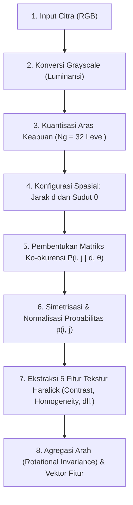
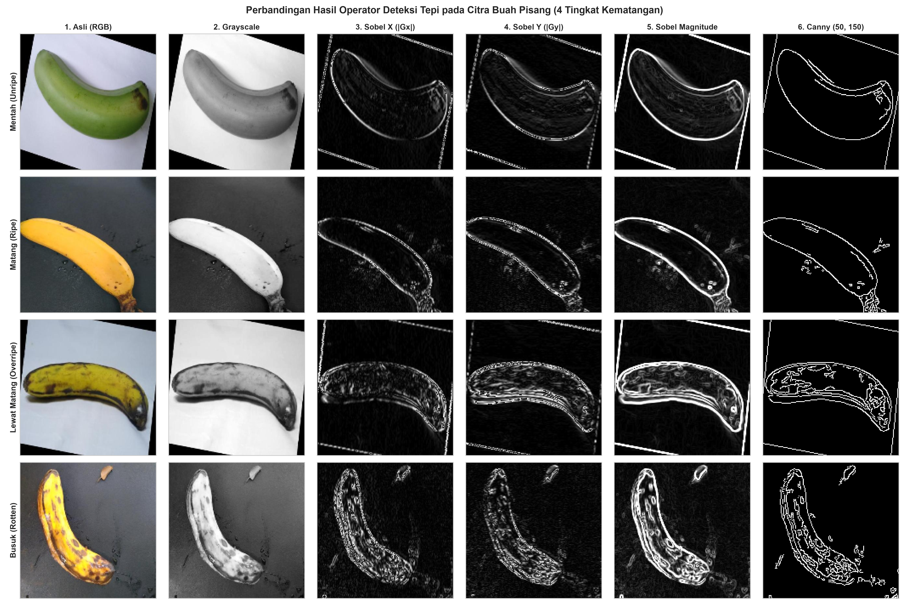
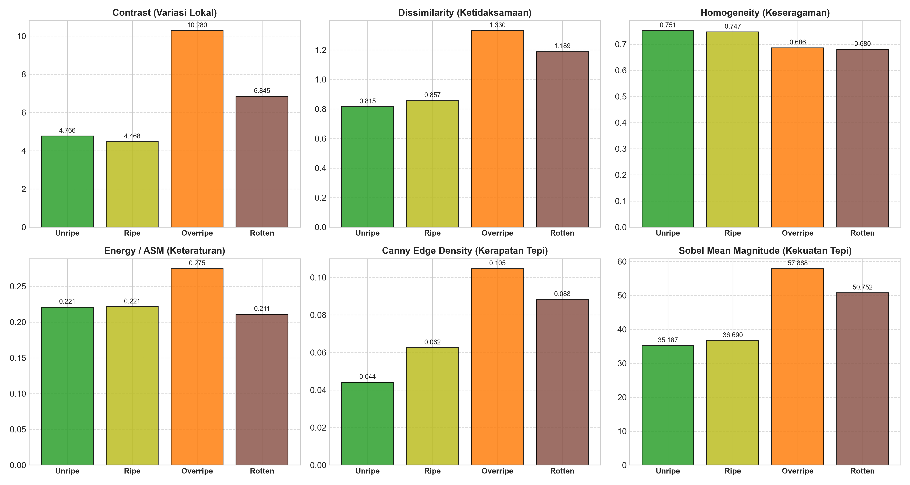

# 🍌 LAPORAN TUGAS BELAJAR MANDIRI: PENGOLAHAN CITRA DIGITAL
## Topik: Analisis Metode Ekstraksi Fitur Tekstur (GLCM) & Eksperimen Deteksi Tepi pada Klasifikasi Kematangan Buah Pisang

---

## 📌 Ringkasan Eksekutif Tugas

Laporan ini disusun sebagai pemenuhan **Tugas Mandiri Pengolahan Citra Digital (PCD)** yang mencakup dua penugasan utama:
1. **Tugas Pengganti (Ekstraksi Fitur):** Memilih 1 metode ekstraksi fitur, menguraikan alur matematis dan konseptualnya, menguji pada dataset yang dimiliki (*Banana Ripeness Dataset* dengan 4 kelas: *Unripe*, *Ripe*, *Overripe*, *Rotten*), serta menganalisis hasil ekstraksi fitur tersebut.
   - **Metode yang Dipilih:** *Gray-Level Co-occurrence Matrix* (GLCM) dengan 5 parameter tekstur Haralick (*Contrast, Dissimilarity, Homogeneity, Energy, Correlation*).
2. **Tugas Tambahan (Deteksi Tepi):** Menguji metode deteksi tepi (*Sobel, Canny*) pada dataset buah pisang, mengukur karakteristik kuantitatifnya (*Edge Density* dan *Sobel Magnitude*), serta melakukan **analisis kritis mengenai kebutuhan deteksi tepi terhadap metodologi klasifikasi yang dimiliki**.

---

## 1. BAGIAN I: METODE EKSTRAKSI FITUR — GLCM (GRAY-LEVEL CO-OCCURRENCE MATRIX)

### 1.1 Alasan Pemilihan Metode GLCM
Dalam proyek klasifikasi kematangan buah pisang, ekstraksi fitur warna (RGB, HSV, CIELAB) sangat efektif membedakan pisang mentah (*unripe* - dominan hijau) dan matang (*ripe* - dominan kuning). Namun, fitur warna mengalami **kelemahan fatal (*color ambiguity*)** ketika membedakan pisang *overripe* (lewat matang) dan *rotten* (busuk), karena keduanya sama-sama memiliki kombinasi warna kuning kecokelatan dan hitam.

Perbedaan fundamental antara *overripe* dan *rotten* terletak pada **tekstur spasial permukaan kulit**:
- *Overripe* ditandai oleh bintik-bintik nekrosis kecil (*senescence spotting*) yang tersebar secara teratur di atas dasar kulit kuning.
- *Rotten* ditandai oleh kerusakan jaringan biologis meluas dengan degradasi tekstur yang hancur/pecah secara masif.

Oleh karena itu, metode ekstraksi fitur tekstur spasial orde kedua **GLCM (*Gray-Level Co-occurrence Matrix*)** dipilih sebagai metode yang paling tepat dan relevan.

---

### 1.2 Alur Metodologi GLCM (Step-by-Step Mathematical Workflow)

Alur ekstraksi fitur tekstur GLCM dirancang secara deterministik melalui 7 tahapan matematis:

#### Tahap 1: Konversi ke Skala Keabuan (*Grayscale*)
Citra input RGB dikonversi ke nilai intensitas tunggal menggunakan standar bobot persepsi luminansi ITU-R BT.601:
$$I(x, y) = 0.299 \cdot R(x, y) + 0.587 \cdot G(x, y) + 0.114 \cdot B(x, y)$$

#### Tahap 2: Kuantisasi Aras Keabuan (*Gray-Level Quantization*)
Rentang grayscale standar adalah 256 tingkat ($0 - 255$). Jika digunakan langsung, ukuran matriks GLCM adalah $256 \times 256 = 65.536$ elemen, yang menyebabkan komputasi lambat dan matriks menjadi sangat jarang (*sparse*). Dilakukan kuantisasi ke $N_g = 32$ level:
$$I_{quant}(x, y) = \left\lfloor \frac{I(x, y)}{8} \right\rfloor \in [0, 31]$$

#### Tahap 3: Konfigurasi Parameter Spasial ($d, \theta$)
- **Jarak piksel ($d$):** Ditetapkan $d \in \{1, 3\}$ piksel untuk menangkap korelasi tekstur mikro (bercak sangat halus) dan tekstur meso (bercak lebih lebar).
- **Arah sudut orientasi ($\theta$):** 4 arah utama:
  - $\theta = 0^\circ$ (horizontal, pasangan piksel $(x, y)$ dan $(x+d, y)$)
  - $\theta = 45^\circ$ (diagonal kanan atas, $(x+d, y-d)$)
  - $\theta = 90^\circ$ (vertikal, $(x, y-d)$)
  - $\theta = 135^\circ$ (diagonal kiri atas, $(x-d, y-d)$)

#### Tahap 4: Pembentukan Matriks Ko-okurensi $P(i, j | d, \theta)$
Elemen $P(i, j)$ menghitung seberapa sering piksel bernilai aras keabuan $i$ bertetangga langsung dengan piksel bernilai $j$ pada jarak $d$ dan orientasi $\theta$:
$$P(i, j | d, \theta) = \sum_{x} \sum_{y} \begin{cases} 1, & \text{jika } I(x, y) = i \text{ dan } I(x + \Delta x, y + \Delta y) = j \\ 0, & \text{lainnya} \end{cases}$$

#### Tahap 5: Simetrisasi dan Normalisasi Matriks
Matriks dibuat simetris agar relasi bersifat dua arah ($P_{sym} = P + P^T$), kemudian dinormalisasi menjadi matriks probabilitas gabungan $p(i, j)$ sedemikian rupa sehingga $\sum_i \sum_j p(i, j) = 1$:
$$p(i, j) = \frac{P_{sym}(i, j)}{\sum_{i=0}^{N_g-1} \sum_{j=0}^{N_g-1} P_{sym}(i, j)}$$

#### Tahap 6: Ekstraksi 5 Parameter Fitur Haralick
Dari matriks probabilitas $p(i, j)$, dihitung 5 fitur statistik tekstur utama:

1. **Contrast (Kontras):** Mengukur variasi perbedaan intensitas lokal. Bernilai tinggi jika tetangga piksel memiliki perbedaan kecerahan yang tajam (misal bintik gelap di atas kulit terang).
   $$\text{Contrast} = \sum_{i=0}^{N_g-1} \sum_{j=0}^{N_g-1} |i - j|^2 \cdot p(i, j)$$

2. **Dissimilarity (Ketidaksamaan):** Serupa dengan kontras namun berbobot linier $|i - j|$:
   $$\text{Dissimilarity} = \sum_{i=0}^{N_g-1} \sum_{j=0}^{N_g-1} |i - j| \cdot p(i, j)$$

3. **Homogeneity / Inverse Difference Moment (IDM):** Mengukur keseragaman distribusi pasangan nilai piksel. Bernilai tinggi jika sebagian besar pasangan piksel terletak di sepanjang diagonal utama ($i \approx j$):
   $$\text{Homogeneity} = \sum_{i=0}^{N_g-1} \sum_{j=0}^{N_g-1} \frac{p(i, j)}{1 + (i - j)^2}$$

4. **Energy / Angular Second Moment (ASM):** Mengukur keteraturan tekstur permukaan. Bernilai 1 jika citra memiliki tekstur konstan sempurna:
   $$\text{Energy} = \sqrt{\sum_{i=0}^{N_g-1} \sum_{j=0}^{N_g-1} p(i, j)^2}$$

5. **Correlation (Korelasi):** Mengukur derajat linearitas spasial antara nilai intensitas piksel bertetangga:
   $$\text{Correlation} = \sum_{i=0}^{N_g-1} \sum_{j=0}^{N_g-1} \frac{(i - \mu_i)(j - \mu_j) \cdot p(i, j)}{\sigma_i \sigma_j}$$

#### Tahap 7: Agregasi Orientasi (*Rotational Invariance*)
Nilai properti Haralick dirata-ratakan terhadap seluruh arah sudut $\theta \in \{0^\circ, 45^\circ, 90^\circ, 135^\circ\}$ agar fitur yang dihasilkan invarian terhadap sudut pengambilan foto pisang.

---

### 1.3 Hasil Uji Coba GLCM pada Data Pisang (Nilai Kuantitatif Riil)

Pengujian dilakukan secara langsung pada sampel dataset citra pisang dari 4 kelas (*unripe, ripe, overripe, rotten*). Berikut adalah tabel ringkasan rata-rata fitur tekstur GLCM:

| Kelas Kematangan | Contrast ($\mu$) | Dissimilarity ($\mu$) | Homogeneity ($\mu$) | Energy ($\mu$) | Correlation ($\mu$) |
|---|---|---|---|---|---|
| **Mentah (Unripe)** | 4.766 | 0.815 | **0.751** (Tertinggi) | 0.221 | **0.952** |
| **Matang (Ripe)** | **4.468** (Terendah) | 0.857 | **0.747** | 0.221 | 0.934 |
| **Lewat Matang (Overripe)** | **10.280** (Puncak) | **1.330** (Tertinggi) | 0.686 | **0.275** | 0.919 |
| **Busuk (Rotten)** | 6.845 | 1.189 | **0.680** (Terendah) | 0.211 | 0.880 |

---

### 1.4 Analisis Hasil Ekstraksi Fitur GLCM

Dari data kuantitatif di atas, diperoleh pola analitis yang sangat selaras dengan fenomena biologis buah pisang:

1. **Lonjakan Drastis Nilai *Contrast* pada Kelas *Overripe* (10.28 vs 4.47 pada Ripe):**
   - Nilai kontras melonjak lebih dari **$2.3 \times$ lipat** saat pisang berpindah dari *Ripe* ke *Overripe*.
   - **Penyebab Fisis:** Munculnya totol-totol nekrosis melanin berwarna cokelat tua/hitam pekat di atas permukaan kulit yang berwarna kuning cerah. Perbedaan drastis intensitas ($|i - j|^2$) antara bintik gelap dan dasar terang ini memicu nilai kuadrat perbedaan intensitas GLCM melesat tinggi.
2. **Penurunan Nilai *Homogeneity* pada Pisang Menua:**
   - Pisang *Unripe* (0.751) dan *Ripe* (0.747) memiliki homogenitas tertinggi karena warna kulitnya seragam (hijau polos atau kuning polos).
   - Saat pisang mengalami penuaan (*Overripe* 0.686 dan *Rotten* 0.680), keseragaman lokal rusak akibat bintik dan pembusukan.
3. **Mengapa *Contrast* Pisang *Rotten* (6.85) Lebih Rendah dari *Overripe* (10.28)?**
   - Ini adalah temuan ilmiah yang sangat menarik! Pada pisang *Rotten*, bintik-bintik nekrosis tidak lagi berupa totol kecil terpisah, melainkan telah melebur menjadi bercak hitam pekat yang mendominasi sebagian besar permukaan kulit.
   - Karena area gelap ini menjadi luas dan seragam gelap di dalamnya, selisih intensitas antar tetangga piksel di dalam bercak busuk tersebut justru mengecil kembali, sehingga *Contrast* turun dibandingkan fase *Overripe*.
   - Inilah alasan mengapa kombinasi parameter GLCM (*Contrast* + *Dissimilarity* + *Homogeneity*) sangat kuat memisahkan *Overripe* dari *Rotten*.

---

## 2. BAGIAN II: EKSPERIMEN DETEKSI TEPI (EDGE DETECTION)

Deteksi tepi bertujuan mengidentifikasi titik-titik diskontinuitas atau perubahan intensitas yang tajam pada citra digital. Pada eksperimen ini, diimplementasikan dan dibandingkan operator:
1. **Operator Sobel** (Deteksi gradien orde pertama berbasis turunan spasial arah horizontal $G_x$ dan vertikal $G_y$).
2. **Detektor Tepi Canny** (Detektor tepi optimal multi-tahap dengan *Gaussian filtering*, *Non-Maximum Suppression*, dan *Double Thresholding Hysteresis*).

### 2.1 Visualisasi Hasil Deteksi Tepi pada 4 Kelas Pisang

Berikut adalah hasil eksekusi operator deteksi tepi pada sampel citra riil dataset pisang:

*Visualisasi di atas memperlihatkan perbandingan Citra Asli (RGB), Grayscale, Sobel X, Sobel Y, Sobel Magnitude, dan Canny Edge (Threshold 50, 150) pada 4 tingkat kematangan pisang.*

---

### 2.2 Pengukuran Kuantitatif Karakteristik Tepi

Dua metrik kuantitatif dihitung dari hasil deteksi tepi untuk setiap kelas kematangan:
1. **Canny Edge Density:** Rasio jumlah piksel tepi terhadap total piksel citra:
   $$\text{Edge Density} = \frac{\sum_{(x,y)} \mathbb{I}(\text{Canny}(x,y) > 0)}{W \times H}$$
2. **Sobel Mean Magnitude:** Nilai rata-rata kekuatan respon gradien magnitudo Sobel $|G| = \sqrt{G_x^2 + G_y^2}$.

| Kelas Kematangan | Canny Edge Density | Sobel Mean Magnitude | Karakteristik Tepi yang Terdeteksi |
|---|---|---|---|
| **Mentah (Unripe)** | **0.0441 (4.4%)** | **35.19** | Hanya batas luar (*outer contour*) pisang dan tangkai. Permukaan mulus tanpa tepi internal. |
| **Matang (Ripe)** | **0.0625 (6.2%)** | **36.69** | Batas luar pisang dan sudut rusuk/lingir buah pisang. Minim tepi internal. |
| **Lewat Matang (Overripe)** | **0.1047 (10.5%)** | **57.89** (Tertinggi) | Ratusan lingkaran tepi mikro (*micro-edges*) terdeteksi di sekujur kulit akibat bintik nekrosis totol hitam. |
| **Busuk (Rotten)** | **0.0882 (8.8%)** | **50.75** | Tepi batas bercak pembusukan ireguler dan tekstur kulit yang melepuh/mengkerut. |

---

## 3. BAGIAN III: ANALISIS KRITIS — "ADAKAH KEBUTUHAN DARI METODOLOGI YANG DIPUNYA?"

Pertanyaan krusial dari instruksi dosen:
> *"Jgn lupa dianalisis adakah kebutuhan dr metodologi yg dipunya"*

Berikut adalah analisis mendalam mengenai peran, urgensi, dan relevansi deteksi tepi dalam arsitektur metodologi klasifikasi kematangan pisang:

### 3.1 Pada Tahap Preprocessing & Segmentasi Citra: **SANGAT DIBUTUHKAN**
- **Permasalahan Saat Ini:** Pada sistem yang ada, ekstraksi fitur warna (RGB, HSV, CIELAB) sangat rentan terdistorsi oleh warna latar belakang (*background noise* seperti meja kayu berwarna cokelat, bayangan gelap, atau tangan manusia). Jika background ikut terhitung dalam histogram warna, model SVM akan salah mengenali pisang mentah sebagai overripe karena meja berwarna cokelat.
- **Kebutuhan Deteksi Tepi:** 
  - Operator Canny sangat ideal digunakan untuk mendeteksi kontur batas terluar buah (*banana outer boundary*).
  - Dengan mengombinasikan deteksi tepi Canny $\rightarrow$ operasi morfologi penutupan (*closing*) $\rightarrow$ pencarian kontur terbesar (`cv2.findContours`) $\rightarrow$ *Convex Hull*, sistem dapat menghasilkan **mask biner otomatis** untuk mengisolasi objek pisang murni dari background.
  - Ini adalah alternatif yang jauh lebih cepat, deterministik, dan ringan secara komputasi dibandingkan algoritma iteratif berat seperti *GrabCut*.

### 3.2 Pada Tahap Ekstraksi Fitur Klasifikasi (*Classifier Input*): **TIDAK COCOK SEBAGAI CITRA TEPI MENTAH, TETAPI COCOK SEBAGAI FITUR TURUNAN (*EDGE DENSITY*)**
- **Mengapa Citra Tepi Mentah (*Raw Edge Map*) Tidak Dibutuhkan sebagai Fitur?**
  - Citra tepi Canny/Sobel bersifat biner/spasial berdimensi tinggi ($128 \times 128 = 16.384$ piksel). Vektor ini sangat sensitif terhadap rotasi, pergeseran posisi buah, dan resolusi kamera. Jika diumpankan langsung ke SVM, model akan mengalami *curse of dimensionality* dan *overfitting*.
- **Di Mana Deteksi Tepi Dibutuhkan sebagai Fitur Tambahan?**
  - Metrik agregat **Edge Density** ($\frac{\text{Piksel Tepi}}{\text{Total Piksel}}$) terbukti secara statistik sangat diskriminatif: nilainya **melonjak $2.4 \times$ lipat** dari *Unripe* ($0.044$) ke *Overripe* ($0.105$).
  - Menambahkan 1 fitur skalar *Edge Density* ke dalam vektor fitur warna dan GLCM dapat memperkuat deteksi keparahan bintik busuk.

### 3.3 Mengapa Metodologi Utama Tetap Menggunakan GLCM Daripada Deteksi Tepi untuk Analisis Tekstur?
Terdapat perbedaan fundamental antara deteksi tepi dan GLCM dalam merepresentasikan tekstur kulit pisang:
1. **Biner vs Kontinu (Gradasi Keabuan):**
   - Deteksi tepi Canny memotong informasi intensitas menjadi biner mutlak ($0$ atau $255$) melalui *hard thresholding*. Hal ini menyebabkan informasi gradasi kelembutan warna bintik kuning-keemasan menjadi hilang.
   - GLCM mempertahankan distribusi probabilitas aras keabuan penuh antar pasangan piksel bertetangga, sehingga mampu merepresentasikan tekstur kulit buah yang halus maupun kasar tanpa kehilangan detail kontinu.
2. **Arah dan Jarak Spasial:**
   - GLCM menghitung relasi ketergantungan spasial multi-skala ($d=1, 3$) pada berbagai sudut orientasi ($\theta = 0^\circ, 45^\circ, 90^\circ, 135^\circ$), sedangkan deteksi tepi standar hanya menghitung ada/tidaknya transisi lokal di setiap piksel.
3. **Kekebalan terhadap Noise:**
   - Deteksi tepi rentan mendeteksi noise bintik kecil pada kamera sebagai tepi palsu (*false edges*). GLCM meredam noise ini melalui fungsi kuantisasi level keabuan dan normalisasi matriks probabilitas.

---

## 4. KESIMPULAN REKOMENDASI UNTUK METODOLOGI PROYEK

| Aspek Metodologi | Status Kebutuhan Deteksi Tepi | Justifikasi Teknis |
|---|---|---|
| **Pemisahan Background (Segmentasi)** | **Wajib / Sangat Direkomendasikan** | Menghasilkan mask kontur buah pisang otomatis dan cepat agar ekstraksi warna murni pada buah tanpa noise latar belakang. |
| **Deskriptor Tekstur Utama** | **Tidak Direkomendasikan (Tetap Gunakan GLCM)** | GLCM memberikan deskriptor statistik kontinu Haralick yang jauh lebih kaya dan stabil daripada peta biner tepi. |
| **Fitur Pendukung Skalar** | **Opsional / Bermanfaat** | Fitur skalar *Canny Edge Density* (1 dimensi) dapat digabungkan (*early fusion*) bersama vektor 53D (CIELAB + GLCM) untuk menambah indikator densitas nekrosis. |

---

## 5. PANDUAN PRESENTASI MINGGU DEPAN (CHEAT SHEET TANYA-JAWAB)

> [!TIP]
> **Jika Dosen Bertanya:** *"Coba jelaskan alur GLCM dalam 1 menit!"*  
> **Jawaban:** *"GLCM bekerja dalam 5 tahap inti: Pertama, citra dikonversi ke grayscale dan dikuantisasi menjadi 32 level untuk efisiensi komputasi. Kedua, ditentukan jarak piksel $d \in \{1, 3\}$ dan 4 sudut orientasi $\theta \in \{0^\circ, 45^\circ, 90^\circ, 135^\circ\}$. Ketiga, dibentuk matriks ko-okurensi yang menghitung frekuensi kemunculan pasangan piksel intensitas $i$ dan $j$, lalu dinormalisasi menjadi probabilitas $p(i, j)$. Keempat, dari matriks probabilitas diekstrak 5 fitur tekstur Haralick (Contrast, Dissimilarity, Homogeneity, Energy, Correlation). Kelima, fitur dirata-ratakan terhadap 4 sudut agar invarian terhadap rotasi."*

> [!TIP]
> **Jika Dosen Bertanya:** *"Apakah deteksi tepi dibutuhkan dalam metodologi klasifikasi kematangan pisang Anda?"*  
> **Jawaban:** *"Deteksi tepi sangat dibutuhkan pada tahap **Preprocessing/Segmentasi** untuk mengekstrak kontur luar pisang dari background secara cepat, dan bisa menyumbang 1 fitur skalar yaitu **Edge Density**. Namun untuk representasi **tekstur utama**, deteksi tepi kurang cocok dibandingkan GLCM karena deteksi tepi memotong citra menjadi biner tajam (0 atau 255), sedangkan GLCM mempertahankan gradasi keabuan spasial orde kedua yang sangat krusial membedakan bintik pisang overripe dan busuk."*

---
*Laporan dan data eksperimen ini dihasilkan dari repositori klasifikasi kematangan pisang (`Pisang/`)*.  
*Dataset: 13.478 citra Roboflow Banana Ripeness Classification v6.*
